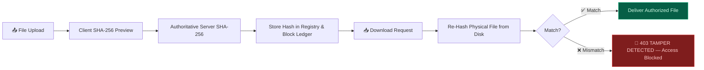
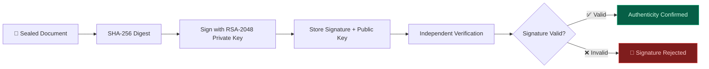
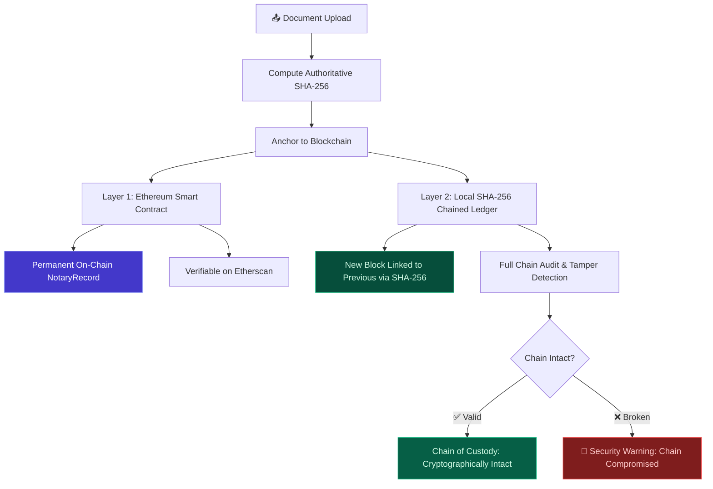
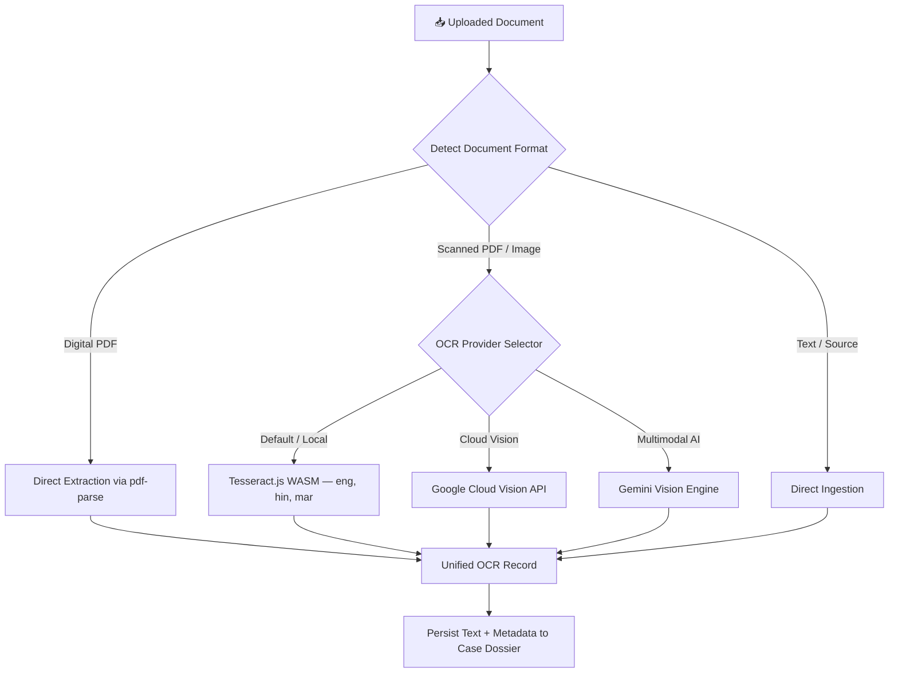
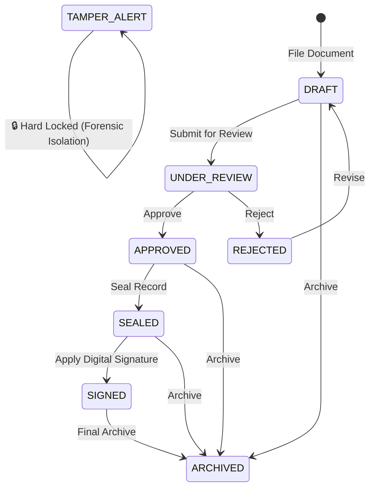

# ⚖️ Vigil.OS — Secure Digital Document Management System

<p align="center">
  
</p>

<p align="center">
  <strong>Forensic-grade digital document lifecycle management, cryptographic integrity verification, RSA digital signatures, multi-engine OCR, and dual-layer blockchain anchoring.</strong><br/>
  <em>Built for SIH Problem Statement 26190 · Judiciary, Law Enforcement & Forensic Investigation Teams</em>
</p>

<p align="center">
  
  
  
  
  
  
  
  
  
  
  
</p>

---

## 📑 Table of Contents

- [Overview](#-overview)
- [System Architecture](#%EF%B8%8F-system-architecture)
- [Key Architectural Pillars](#-key-architectural-pillars)
  - [1. SHA-256 Forensic Integrity Engine](#1--sha-256-forensic-integrity-engine)
  - [2. RSA-SHA256 Digital Signature Engine](#2--rsa-sha256-digital-signature-engine)
  - [3. Dual-Layer Blockchain Notarization](#3-%EF%B8%8F-dual-layer-blockchain-notarization)
  - [4. Multi-Engine OCR Processing](#4--multi-engine-ocr-processing-pipeline)
  - [5. Role-Based Access Control & Classification](#5--role-based-access-control-rbac)
  - [6. Document Workflow Lifecycle](#6--document-workflow-state-machine)
- [Repository Structure](#-repository-structure)
- [Pages & UI](#-pages--ui)
- [Smart Contract & Web3 Integration](#-smart-contract--web3-integration)
- [Getting Started](#-getting-started)
- [Environment Configuration](#-environment-configuration)
- [Supabase Setup](#-supabase-setup)
- [Automated Testing](#-automated-testing)
- [API Server Functions](#%EF%B8%8F-api-server-functions-reference)
- [Demo Credentials](#-demo-credentials)
- [Deployment](#-deployment)

---

## 🌟 Overview

**Vigil.OS** provides a tamper-proof chain of custody for digital evidence, legal petitions, court proceedings, and sensitive case files.

- **Zero-Trust Verification**: Every uploaded file is hashed client-side and server-side with SHA-256; downloads pass through an active gate that re-computes hashes on-the-fly to prevent serving altered content.
- **RSA-2048 Digital Signatures**: Real public-key cryptography (PKCS#1 v1.5, SHA-256) for legally-binding digital signing and independent signature verification.
- **Ethereum Smart Contract Notarization**: Anchors document hashes permanently on Ethereum (Sepolia testnet / Mainnet) via an immutable Solidity smart contract (`DocumentNotary.sol`) — supports both client-side MetaMask signing and server-side automated notarization.
- **Local Cryptographic Ledger**: Maintains a chained SHA-256 audit ledger (`.data/blockchain-ledger.json`) with cryptographic block linkage, Genesis block verification, and real-time tamper detection.
- **Tri-Engine Intelligent OCR**: Automatically extracts text from digital PDFs, scanned images, and multi-page documents using local Tesseract WASM, Google Cloud Vision, or Google Gemini AI Vision.
- **Hybrid Storage Backends**: Supports local filesystem, Supabase Storage (S3-compatible), AWS S3 via gateway, and Google Cloud Storage.
- **Integrity Certificates**: Generate downloadable, printable forensic integrity certificates for any document with full SHA-256 audit trails.
- **Supabase Cloud Database**: Full PostgreSQL-backed persistence with Row Level Security, normalized relational tables, and real-time sync.
- **Cloudflare Edge Deployment**: Production builds via Nitro with Cloudflare Module worker target.

---

## 🏗️ System Architecture

```mermaid
graph TD
    User([👤 User / Investigator / Judge]) -->|MetaMask Connect| Web3[Wagmi / Viem Provider]
    User -->|Session Auth| Client[Vigil.OS Frontend — React 19 + TailwindCSS 4]

    Client -->|Web3 RPC Calls| Alchemy[Alchemy Ethereum RPC]
    Alchemy -->|On-Chain Transactions| Contract[DocumentNotary.sol — Sepolia / Mainnet]

    Client -->|Server Functions RPC| ServerFn[TanStack Start Server Layer]

    ServerFn -->|Session & RBAC| Auth[Auth Engine — auth.server.ts]
    ServerFn -->|SHA-256 Digest| Crypto[Crypto Engine — crypto.server.ts]
    ServerFn -->|RSA Signing| DSig[Digital Signature Engine — digital-signature.server.ts]
    ServerFn -->|Case & Doc CRUD| DMS[DMS Engine — dms.server.ts]
    ServerFn -->|OCR Dispatcher| OCR[OCR Service — src/lib/ocr/]
    ServerFn -->|Server Notarize| EthServer[Ethereum Server — ethereum.server.ts]

    OCR -->|Local WASM| Tesseract[Tesseract.js — Eng / Hin / Mar]
    OCR -->|Cloud Vision| GCV[Google Cloud Vision Provider]
    OCR -->|Multimodal AI| Gemini[Gemini 1.5/2.0 Vision Provider]
    OCR -->|Digital PDF| PDFParse[pdf-parse Stream Extractor]

    DMS -->|Local Registry| DB[(JSON Registry — .data/registry.json)]
    DMS -->|Local Storage| Disk[(Secure Disk Store — .data/storage/)]
    DMS -->|Cloud DB & Buckets| Supabase[(Supabase Postgres + S3 Bucket)]
    DMS -->|AWS S3| S3[(AWS S3 via Gateway)]
    DMS -->|Enterprise Cloud| GCS[(Google Cloud Storage Bucket)]
    DMS -->|Immutable Audit| Ledger[(Local SHA-256 Chained Ledger)]

    style User fill:#1e293b,stroke:#60a5fa,color:#f8fafc
    style Client fill:#0f172a,stroke:#38bdf8,color:#e2e8f0
    style Web3 fill:#6366f1,stroke:#818cf8,color:#ffffff
    style Contract fill:#4338ca,stroke:#a5b4fc,color:#ffffff
    style ServerFn fill:#1e1b4b,stroke:#818cf8,color:#e0e7ff
    style Auth fill:#1e3a5f,stroke:#38bdf8,color:#e2e8f0
    style Crypto fill:#1e3a5f,stroke:#38bdf8,color:#e2e8f0
    style DSig fill:#1e3a5f,stroke:#38bdf8,color:#e2e8f0
    style DMS fill:#1e3a5f,stroke:#38bdf8,color:#e2e8f0
    style OCR fill:#3b1f6e,stroke:#a78bfa,color:#ede9fe
    style EthServer fill:#4338ca,stroke:#a5b4fc,color:#ffffff
    style Ledger fill:#064e3b,stroke:#34d399,color:#d1fae5
    style Supabase fill:#065f46,stroke:#10b981,color:#d1fae5
    style S3 fill:#065f46,stroke:#10b981,color:#d1fae5
```



---

## 🔑 Key Architectural Pillars

### 1. 🔒 SHA-256 Forensic Integrity Engine

Vigil.OS strictly satisfies legal evidentiary admissibility standards by enforcing cryptographic integrity across every touchpoint:

| Checkpoint | Implementation | Protection |
| :--- | :--- | :--- |
| **Client Pre-Hash** | Web Crypto `SubtleCrypto.digest("SHA-256")` | Computes preview digest prior to transmission |
| **Server Digest** | Node.js `crypto.createHash("sha256")` | Streaming hash computation from raw uploaded bytes |
| **Tamper Defense** | `crypto.timingSafeEqual()` | Constant-time comparison to prevent side-channel timing attacks |
| **Download Gate** | Active streaming re-hash | Physical file re-hashed before transfer; mismatches trigger `TAMPER_ALERT` |
| **Bulk Verification** | `bulkVerifyIntegrityFn` | Batch integrity audit across all documents in the registry |
| **Tamper Diagnostic** | Simulation endpoint (`simulateTamperFn`) | Injects byte flips for live judge demonstrations and recovery tests |



📖 **Detailed Documentation**: See [`SHA256_INTEGRITY.md`](SHA256_INTEGRITY.md)

---

### 2. ✍️ RSA-SHA256 Digital Signature Engine

Vigil.OS implements real public-key cryptography for legally-binding digital signatures:

| Feature | Implementation |
| :--- | :--- |
| **Key Generation** | RSA-2048 key pairs generated per signer via Node.js `crypto.generateKeyPairSync()` |
| **Signing** | SHA-256 digest of document bytes signed with RSA private key (PKCS#1 v1.5) |
| **Verification** | Independent signature verification using signer's RSA public key |
| **Key Storage** | PEM-encoded key pairs stored securely in `.data/keys/` |
| **Standards** | PKCS#1 v1.5, SHA-256 — legally admissible digital signature standard |



---

### 3. ⛓️ Dual-Layer Blockchain Notarization

Vigil.OS directly addresses **SIH Problem Statement 26190** by implementing a dual-layer blockchain notarization system that provides immutable, cryptographically verifiable proof-of-existence and chain-of-custody for all digital evidence and legal documents:

#### A. Public Ethereum Notarization (MetaMask + Alchemy)
- **Smart Contract**: [`contracts/DocumentNotary.sol`](contracts/DocumentNotary.sol) compiled with Solidity `^0.8.20`.
- **Permanent On-Chain Storage**:
  ```solidity
  struct NotaryRecord {
      bytes32 sha256Hash;       // SHA-256 hash of document
      string  documentId;       // Vigil.OS internal document ID
      string  documentName;     // Document name
      address notarizedBy;      // Signer wallet address
      uint256 timestamp;        // Immutable block timestamp
      bool    exists;           // Anti-overwrite guard
  }
  ```
- **Client-Side Wallet**: Connects to MetaMask using Wagmi v2 and Viem for user-initiated notarization.
- **Server-Side Notarization**: Automated notarization via `ethereum.server.ts` using Ethers.js — no wallet popup required.
- **In-App Contract Deployment**: `DeployContractModal` allows deploying `DocumentNotary.sol` directly from the UI with embedded bytecode.
- **Alchemy Infrastructure**: High-throughput JSON-RPC endpoints configured for Ethereum Sepolia testnet or Ethereum Mainnet.
- **Contract Verification**: Direct deep-links to [Sepolia Etherscan](https://sepolia.etherscan.io).
- **Live Contract**: [`0xd901f31DAd885610Ab4aBe0f2494B28d06E09Def`](https://sepolia.etherscan.io/address/0xd901f31DAd885610Ab4aBe0f2494B28d06E09Def) on Sepolia.

#### B. Local Chained Cryptographic Ledger
- Implemented in `src/lib/blockchain.server.ts`.
- Chained JSON ledger (`.data/blockchain-ledger.json`) linking each notarization to the previous block's SHA-256 hash.
- Cryptographic chain link: `txId = SHA-256(prevTxId : metadataHash : timestamp)` — any single tampered block breaks the entire chain.
- Independent validation endpoint (`verifyBlockchainEntryFn`) capable of auditing complete block chains and isolating tampered blocks.
- **Enterprise-Ready**: Drop-in hooks ready for Hyperledger Fabric peers via gRPC.



📖 **Detailed Documentation**: See [`BLOCKCHAIN_ARCHITECTURE.md`](BLOCKCHAIN_ARCHITECTURE.md)

---

### 4. 🔍 Multi-Engine OCR Processing Pipeline

The OCR subsystem extracts text, determines searchable indices, and structures forensic evidence across image and scanned document types:



- **Languages Supported**: English (`eng`), Hindi (`hin`), Marathi (`mar`).
- **Forensic Guarantee**: The SHA-256 cryptographic digest is calculated strictly from raw file bytes before OCR parsing. Re-running OCR never impacts the document's cryptographic hash.

📖 **Detailed Documentation**: See [`OCR_ARCHITECTURE.md`](OCR_ARCHITECTURE.md)

---

### 5. 🔑 Role-Based Access Control (RBAC)

Five clearance tiers enforce role-based access to dossiers and documents:

| Role | Clearance | File Upload | Sign & Seal | Induct Assets | User Admin | Review & Approve |
| :--- | :---: | :---: | :---: | :---: | :---: | :---: |
| **Admin** | Level 4 | ✅ | ✅ | ✅ | ✅ | ✅ |
| **Investigator** | Level 3 | ✅ | ✅ | ✅ | ❌ | ✅ |
| **Legal Officer** | Level 3 | ✅ | ✅ | ❌ | ❌ | ✅ |
| **Court Officer** | Level 2 | ✅ | ❌ | ❌ | ❌ | ❌ |
| **Viewer** | Level 1 | ❌ | ❌ | ❌ | ❌ | ❌ |

#### Document Security Classifications
`PUBLIC (0)` → `RESTRICTED (1)` → `CONFIDENTIAL (2)` → `SECRET (3)` → `TOP SECRET (4)`

---

### 6. 📂 Document Workflow State Machine

Documents progress through a strict lifecycle audit chain:



---

## 📁 Repository Structure

```
judicator-docs/
├── contracts/
│   └── DocumentNotary.sol                  # Solidity 0.8.20 Smart Contract
├── scripts/
│   ├── deploy.cjs                          # Automated deployment & .env update script
│   └── test-blockchain.cjs                 # Blockchain integration test script
├── supabase/
│   └── schema.sql                          # PostgreSQL schema with RLS policies
├── public/
│   ├── favicon.png                         # Shield security icon
│   └── robots.txt
├── src/
│   ├── components/
│   │   ├── dms/
│   │   │   ├── actor.tsx                   # Role badge & user context provider
│   │   │   ├── analytics-charts.tsx        # Recharts analytics widgets
│   │   │   ├── confirm-dialog.tsx          # Destructive action modals
│   │   │   ├── integrity-certificate.tsx   # Downloadable forensic integrity certificate
│   │   │   ├── notification-bell.tsx       # Live notification bell
│   │   │   ├── primitives.tsx              # UI stat cards, panels & shared primitives
│   │   │   ├── records.tsx                 # Document table with inline actions
│   │   │   ├── search-filters.tsx          # Search and classification filter bar
│   │   │   ├── share-panel.tsx             # Temporal document sharing panel
│   │   │   ├── shell.tsx                   # Navigation sidebar & application shell
│   │   │   └── workflow-actions.tsx        # State transition action buttons
│   │   └── ui/                             # Radix UI primitives (shadcn/ui)
│   ├── hooks/
│   │   └── use-mobile.tsx                  # Responsive viewport hook
│   ├── lib/
│   │   ├── auth.functions.ts               # Auth RPC server functions
│   │   ├── auth.server.ts                  # Session engine, token management & password hashing
│   │   ├── blockchain.server.ts            # Local SHA-256 chained block ledger
│   │   ├── crypto.server.ts                # Forensic SHA-256 crypto engine
│   │   ├── digital-signature.server.ts     # RSA-2048 / SHA-256 digital signature engine
│   │   ├── dms-types.ts                    # Domain TypeScript interfaces & constants
│   │   ├── dms.functions.ts                # DMS RPC server functions (31 endpoints)
│   │   ├── dms.server.ts                   # DMS business logic & workflows
│   │   ├── error-capture.ts                # Error capture & diagnostic formatting
│   │   ├── error-page.ts                   # Error boundary page renderer
│   │   ├── error-reporting.ts              # Error reporting pipeline
│   │   ├── google-cloud-storage.server.ts  # GCS bucket client
│   │   ├── registry.server.ts              # JSON database abstraction layer
│   │   ├── s3.server.ts                    # AWS S3 gateway storage adapter
│   │   ├── seed-registry.ts                # Demo data seeding & initial registry
│   │   ├── storage.server.ts               # Local disk filesystem adapter
│   │   ├── supabase-auth.server.ts         # Supabase Auth integration
│   │   ├── supabase-db.server.ts           # Supabase PostgreSQL database client
│   │   ├── supabase-storage.server.ts      # Supabase S3-compatible object storage client
│   │   ├── supabase.ts                     # Supabase client initialization & config
│   │   ├── utils.ts                        # Shared utility functions
│   │   ├── ethereum/                       # Web3 & Ethereum integration
│   │   │   ├── bytecode.ts                 # Compiled contract bytecode for in-app deploy
│   │   │   ├── config.ts                   # Wagmi / Viem chain configuration
│   │   │   ├── contract.ts                 # Contract ABI & addresses
│   │   │   ├── ethereum.server.ts          # Server-side Ethers.js notarization engine
│   │   │   ├── DeployContractModal.tsx     # In-app smart contract deployment modal
│   │   │   ├── NotarizeButton.tsx          # On-chain notarization action UI
│   │   │   ├── WalletButton.tsx            # MetaMask connect / disconnect button
│   │   │   ├── useNotarize.ts              # Wagmi notarize mutation hook
│   │   │   └── useVerifyOnChain.ts         # On-chain verification query hook
│   │   └── ocr/                            # OCR engine providers
│   │       ├── gemini-ocr-provider.ts      # Gemini Vision AI provider
│   │       ├── google-vision-provider.ts   # Google Cloud Vision provider
│   │       ├── ocr-service.ts              # Orchestrator & dispatcher
│   │       ├── ocr-types.ts                # OCR contracts & types
│   │       ├── pdf-extractor.ts            # Direct stream PDF extractor
│   │       └── tesseract-provider.ts       # Tesseract.js WASM provider
│   ├── routes/
│   │   ├── __root.tsx                      # Root layout with Wagmi & Query providers
│   │   ├── index.tsx                       # Executive dashboard & metrics
│   │   ├── login.tsx                       # User authentication page
│   │   ├── about.tsx                       # About page — architecture & SIH alignment
│   │   ├── blockchain.tsx                  # Dual Ledger & Ethereum Notary UI
│   │   ├── cases.index.tsx                 # Case dossier index
│   │   ├── cases.$caseId.tsx               # Case dossier document workspace
│   │   ├── documents.tsx                   # Global document directory
│   │   ├── documents.$docId.tsx            # Forensic document viewer & on-chain notarize
│   │   ├── audit.tsx                       # System audit trail viewer
│   │   ├── assets.tsx                      # Physical evidence & asset tracker
│   │   ├── reports.tsx                     # Integrity certificates & audit exports
│   │   ├── settings.tsx                    # System config, storage & connectivity status
│   │   ├── users.tsx                       # User management & role assignment
│   │   ├── notifications.tsx               # Alert center
│   │   └── profile.tsx                     # Profile and credentials view
│   ├── server.ts                           # Nitro server entry with error handling
│   ├── start.ts                            # TanStack Start entry point
│   ├── router.tsx                          # Router configuration
│   ├── styles.css                          # Global TailwindCSS 4 stylesheet
│   └── routeTree.gen.ts                    # Auto-generated route tree
├── tests/
│   ├── integrity.test.ts                   # 12 SHA-256 integrity unit tests
│   └── ocr.test.ts                         # 11 OCR engine unit tests
├── .data/                                  # Local persistent storage (git-ignored)
│   ├── registry.json                       # Local database file
│   ├── blockchain-ledger.json              # Local SHA-256 block ledger
│   ├── keys/                               # RSA key pair storage (per signer)
│   └── storage/vigil/cases/                # Physical file storage directory
├── hardhat.config.cjs                      # Hardhat Solidity compilation config
├── package.json
├── tsconfig.json
├── vite.config.ts                          # Vite 8 + TanStack Start + Nitro config
├── eslint.config.js                        # ESLint flat config
└── components.json                         # shadcn/ui component config
```

---

## 🖥️ Pages & UI

| Route | Page | Description |
| :--- | :--- | :--- |
| `/` | **Dashboard** | Executive overview with case metrics, document stats, and activity feed |
| `/login` | **Login** | Role-based authentication with pre-seeded demo accounts |
| `/cases` | **Case Dossiers** | Create and manage legal/forensic case dossiers |
| `/cases/:caseId` | **Case Workspace** | Upload documents, manage evidence within a specific case |
| `/documents` | **Document Directory** | Browse all documents with search, filters, and classification tags |
| `/documents/:docId` | **Document Viewer** | Forensic document detail — integrity checks, OCR, notarize, sign, share |
| `/blockchain` | **Blockchain Ledger** | View local chain, Ethereum transactions, verify & notarize on-chain |
| `/audit` | **Audit Trail** | Complete system-wide audit log with timestamp and actor tracking |
| `/assets` | **Asset Tracker** | Physical evidence and equipment lifecycle management |
| `/reports` | **Reports** | Generate integrity certificates, audit exports, and case summaries |
| `/settings` | **System Settings** | Monitor storage backends, OCR providers, blockchain connectivity |
| `/users` | **User Management** | Create, edit, and manage users with role assignment (Admin only) |
| `/notifications` | **Alert Center** | View and manage system notifications |
| `/profile` | **Profile** | User profile, credentials, and password management |
| `/about` | **About** | Architecture overview, tech stack, and SIH 26190 alignment |

---

## ⚡ Smart Contract & Web3 Integration

### 1. Compile the Smart Contract
Compile [`contracts/DocumentNotary.sol`](contracts/DocumentNotary.sol) using Hardhat:
```bash
npm run contract:compile
```

### 2. Deploy to Ethereum Sepolia Testnet
Add your deployer wallet private key to `.env`:
```env
SEPOLIA_PRIVATE_KEY=your_metamask_private_key_here
```
Deploy with one command:
```bash
npm run contract:deploy:sepolia
```
*The script automatically deploys the contract, prints the transaction hash and Etherscan link, and writes the resulting address to `VITE_CONTRACT_ADDRESS` in `.env`.*

### 3. Deploy from the UI
Use the **Deploy Contract** modal on the Blockchain page to deploy `DocumentNotary.sol` directly from MetaMask — no CLI required. The embedded bytecode and ABI are bundled in the app.

### 4. Deploy to Local Test Network
To run an instant deployment against a local in-memory node:
```bash
npm run contract:deploy:local
```

### 5. Verify on Etherscan
```bash
npm run contract:verify:sepolia
```

### 6. Alternative: Deploy via Remix IDE
1. Open [remix.ethereum.org](https://remix.ethereum.org).
2. Paste [`contracts/DocumentNotary.sol`](contracts/DocumentNotary.sol).
3. Compile with Solidity `0.8.20`.
4. Under **Deploy & Run Transactions**, select **Injected Provider - MetaMask**.
5. Deploy to Sepolia and paste the deployed address into `VITE_CONTRACT_ADDRESS` in `.env`.

---

## 🚀 Getting Started

### Prerequisites
- **Node.js** v18.0.0 or higher
- **npm** v9.0.0 or higher (or **Bun** for faster installs)
- **MetaMask Browser Extension** (for Web3 features)

### Installation

```bash
# 1. Clone the repository
git clone https://github.com/pranavkadam-cs/judicator-docs.git
cd judicator-docs

# 2. Install all dependencies
npm install

# 3. Copy the environment template and fill in your secrets
cp .env.example .env

# 4. Compile the Solidity smart contract
npm run contract:compile

# 5. Start the local development server
npm run dev
```

Open **`http://localhost:8080`** in your browser.

---

## ⚙️ Environment Configuration

Create a `.env` file in the project root (reference [`.env.example`](.env.example)):

```env
# ── OCR Subsystem ───────────────────────────────────────────────
GEMINI_API_KEY=your_gemini_api_key
GOOGLE_CLOUD_PROJECT_NUMBER=your_project_number
GOOGLE_CLOUD_VISION_API_KEY=your_cloud_vision_key

# OCR Provider Selection: "auto" | "gemini" | "google-vision" | "tesseract"
OCR_PROVIDER=auto

# ── Hyperledger Fabric (blank = simulation mode) ────────────────
FABRIC_PEER_ENDPOINT=
FABRIC_MSP_ID=
FABRIC_CHANNEL_NAME=
FABRIC_CHAINCODE_NAME=
FABRIC_CERT_PATH=
FABRIC_KEY_PATH=
FABRIC_TLS_CERT_PATH=

# ── Supabase (blank = local fallback) ───────────────────────────
SUPABASE_URL=https://your-project.supabase.co
SUPABASE_ANON_KEY=your_anon_key
SUPABASE_SERVICE_ROLE_KEY=your_service_role_key
SUPABASE_STORAGE_BUCKET=evidence-vault

# ── Ethereum / Alchemy / MetaMask ───────────────────────────────
VITE_ALCHEMY_RPC_URL=https://eth-sepolia.g.alchemy.com/v2/your_key
VITE_ALCHEMY_API_KEY=your_alchemy_api_key
VITE_ETH_NETWORK=sepolia
VITE_CHAIN_ID=11155111
VITE_CONTRACT_ADDRESS=0xYourDeployedContractAddress
SEPOLIA_PRIVATE_KEY=your_deployer_wallet_private_key

# ── Etherscan (optional — for contract verification) ────────────
ETHERSCAN_API_KEY=your_etherscan_api_key
```

> **Fallback Mode**: If cloud keys are left blank, Vigil.OS automatically falls back to local Tesseract OCR, local filesystem storage, and the local JSON registry.

---

## 🗄️ Supabase Setup

Vigil.OS uses Supabase as its cloud database and storage backend. To set up:

1. Create a project at [supabase.com](https://supabase.com).
2. Navigate to **SQL Editor** and run the schema from [`supabase/schema.sql`](supabase/schema.sql).
3. Create a storage bucket named `evidence-vault` (Settings → Storage).
4. Copy your project URL and API keys to `.env`.

The schema creates:
- `vigil_registry_snapshot` — Atomic state synchronization table
- `vigil_users` — User accounts with password hashes
- `vigil_cases` — Legal/forensic case dossiers
- `vigil_documents` — Document metadata with SHA-256 hashes
- `vigil_audit_log` — Immutable audit trail
- Row Level Security (RLS) policies for all tables

---

## 🧪 Automated Testing

The repository includes a comprehensive 23-test automated test suite covering SHA-256 integrity, tamper detection, RBAC boundaries, versioning, and the OCR engine:

```bash
# Run all 23 tests
npm test

# Run only SHA-256 integrity & tamper detection tests (12 tests)
npm run test:integrity

# Run only OCR engine tests (11 tests)
npm run test:ocr

# Run blockchain integration tests on Sepolia
npm run test:blockchain
```

### Test Suite Summary
```
▶ SIH Problem Statement 26190: SHA-256 File Integrity Verification Engine
  ✔ TEST 1:  Upload file → SHA-256 generated automatically
  ✔ TEST 2:  Identical file → Identical hash
  ✔ TEST 3:  One byte change → Avalanche effect verified
  ✔ TEST 4:  Untouched file download → Verification passes
  ✔ TEST 5:  Tampered file download → Blocked with tamper alert
  ✔ TEST 6:  Missing stored hash → Not silently trusted
  ✔ TEST 7:  Unauthorized clearance → Access blocked
  ✔ TEST 8:  Large file → Streaming hash without memory spikes
  ✔ TEST 9:  File versioning → Independent version hashes
  ✔ TEST 10: Existing upload/download functionality intact
  ✔ TEST 11: Google Cloud Storage adapter exports
  ✔ TEST 12: Supabase database and storage exports

▶ Judicator Docs — OCR Engine
  ✔ TEST 1:  Digital PDF → Direct text extraction
  ✔ TEST 2:  Image document → Routes to OCR
  ✔ TEST 3:  Multi-language parameter (Hindi / Marathi) propagation
  ✔ TEST 4:  Upload pipeline auto-hashing + OCR
  ✔ TEST 5:  OCR failure containment (original document untouched)
  ✔ TEST 6:  Classified document OCR text RBAC clearance gating
  ✔ TEST 7:  Lightweight OCR status query
  ✔ TEST 8:  Manual re-run OCR on archived records
  ✔ TEST 9:  Unsupported file types gracefully handled
  ✔ TEST 10: Custom OCR provider pluggability
  ✔ TEST 11: Gemini OCR provider initialization

23 passed, 0 failed
```

---

## 🛰️ API Server Functions Reference

All backend capabilities are exposed via type-safe TanStack Start server functions.

### Auth RPC (`src/lib/auth.functions.ts`)
| Function | Method | Description |
| :--- | :---: | :--- |
| `loginFn` | POST | Authenticate user with email & password, returns session |
| `logoutFn` | POST | Destroy active session |
| `getSessionFn` | GET | Retrieve current session & user profile |
| `changePasswordFn` | POST | Change user password with current password verification |
| `createUserFn` | POST | Create new user account (Admin only) |
| `updateUserFn` | POST | Update user profile or role (Admin only) |
| `listUsersFn` | GET | List all registered users (Admin only) |

### Document & Integrity RPC (`src/lib/dms.functions.ts`)
| Function | Method | Description |
| :--- | :---: | :--- |
| `fileDocument` | POST | Upload file, compute SHA-256, trigger OCR, log audit |
| `requestDownload` | POST | Active integrity gate: re-hashes file and blocks if tampered |
| `checkIntegrity` | POST | Explicit integrity check against authoritative hash |
| `bulkVerifyIntegrityFn` | POST | Batch verification across all documents |
| `advanceWorkflowFn` | POST | Progress document through workflow states |
| `applySignature` | POST | Apply RSA-SHA256 digital signature to sealed documents |
| `verifySignatureFn` | POST | Independently verify a document's digital signature |
| `reclassifyDocument` | POST | Change document clearance level |
| `simulateTamperFn` | POST | Diagnostic tool to simulate byte tampering |
| `restoreDocumentFn` | POST | Restore document from secure backup |
| `searchDocumentsFn` | POST | Full-text search across all documents |

### Blockchain & Notary RPC
| Function | Method | Description |
| :--- | :---: | :--- |
| `getBlockchainLedgerFn` | GET | Retrieve complete local SHA-256 block ledger |
| `verifyBlockchainEntryFn` | POST | Audit chain integrity and detect broken links |
| `notarizeOnSepoliaFn` | POST | Server-side Ethereum notarization (no MetaMask required) |
| `verifyOnSepoliaFn` | POST | Server-side on-chain verification |
| `getSepoliaStatusFn` | GET | Check Sepolia network connectivity & contract status |
| `updateContractAddressFn` | POST | Update the deployed contract address at runtime |

### OCR Operations RPC
| Function | Method | Description |
| :--- | :---: | :--- |
| `triggerOCR` | POST | Trigger or re-run OCR with language selection |
| `getExtractedText` | POST | Fetch extracted document text (clearance-gated) |
| `getOCRStatus` | POST | Lightweight query for OCR completion status |

### Case, Sharing & Asset Management RPC
| Function | Method | Description |
| :--- | :---: | :--- |
| `openCase` | POST | Open new legal / forensic case dossier |
| `updateCaseFn` | POST | Update case priority, status, or assigned team |
| `fetchSnapshot` | GET | Fetch registry snapshot filtered by user clearance |
| `shareDocumentFn` | POST | Create time-limited access share |
| `revokeShareFn` | POST | Revoke active document share |
| `toggleShare` | POST | Enable/disable sharing for a document |
| `inductAsset` | POST | Register physical evidence or equipment asset |
| `moveAssetStage` | POST | Advance asset through lifecycle stages |

### Notifications & System RPC
| Function | Method | Description |
| :--- | :---: | :--- |
| `markNotificationReadFn` | POST | Mark a notification as read |
| `markAllNotificationsReadFn` | POST | Mark all notifications as read |
| `fetchSupabaseStatus` | GET | Check Supabase connectivity and sync status |

---

## 🎫 Demo Credentials

Pre-seeded user accounts for testing different clearance tiers:

| Email | Password | Role | Clearance Level | Badge ID |
| :--- | :--- | :--- | :---: | :--- |
| `admin@vigil.os` | `admin123` | **Admin** | Level 4 (Top Secret) | `REC-0001` |
| `investigator@vigil.os` | `invest123` | **Investigator** | Level 3 (Secret) | `MH-1180` |
| `legal@vigil.os` | `legal123` | **Legal Officer** | Level 3 (Secret) | `PP-0092` |
| `court@vigil.os` | `court123` | **Court Officer** | Level 2 (Confidential) | `MH-4471` |
| `viewer@vigil.os` | `viewer123` | **Viewer** | Level 1 (Restricted) | `FSL-303` |

---

## 🚢 Deployment

### Development
```bash
npm run dev
```
Starts the Vite dev server at `http://localhost:8080`.

### Production Build
```bash
# Build production bundle (Cloudflare Module target via Nitro)
npm run build

# Preview production build locally
npm run preview
```

### Cloudflare Workers
The project is configured with [Nitro](https://nitro.build/) targeting `cloudflare-module` for edge deployment. The production build outputs a Cloudflare Worker-compatible bundle.

---

## 🛠️ Tech Stack

| Layer | Technology |
| :--- | :--- |
| **Frontend** | React 19, TailwindCSS 4, Radix UI, Recharts, Lucide Icons |
| **Framework** | TanStack Start (Router + Server Functions) |
| **Bundler** | Vite 8 with LightningCSS |
| **Language** | TypeScript 5.8 |
| **Blockchain** | Solidity 0.8.20, Ethers.js 6, Wagmi 3, Viem 2 |
| **Smart Contract Tools** | Hardhat, Sepolia Testnet, Alchemy RPC |
| **OCR** | Tesseract.js 7 (WASM), Google Cloud Vision, Google Gemini AI |
| **Database** | Supabase PostgreSQL (cloud) / JSON Registry (local) |
| **Storage** | Supabase Storage, AWS S3, Google Cloud Storage, Local Disk |
| **Auth** | Session-based with bcrypt password hashing |
| **Crypto** | SHA-256 (integrity), RSA-2048 (signatures), PKCS#1 v1.5 |
| **Server Runtime** | Nitro (Cloudflare Module target) |
| **Testing** | Node.js test runner via tsx |
| **Code Quality** | ESLint 9, Prettier |

---

<p align="center">
  <strong>Vigil.OS</strong> — Securing Justice Through Cryptographic Integrity<br/>
  <em>Smart India Hackathon · Problem Statement 26190</em><br/><br/>
  Last updated: September 2026
</p>
